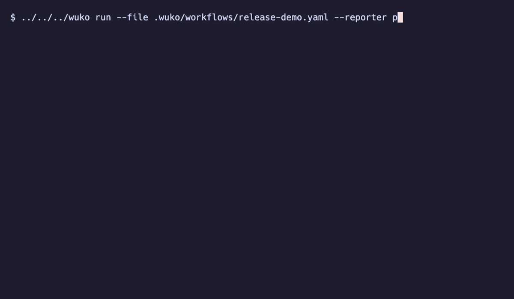
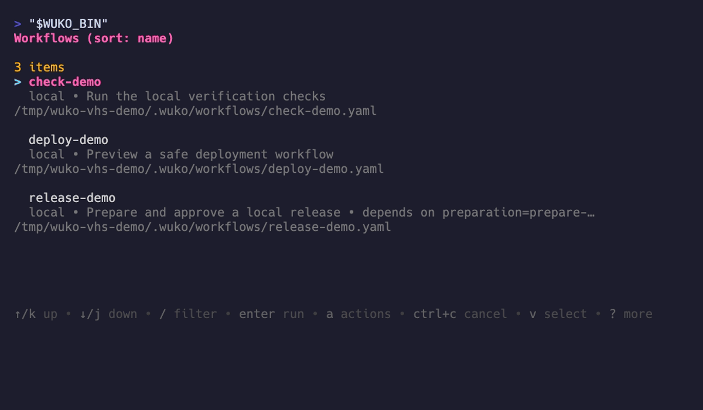

<h1 align="center">Wuko</h1>

<p align="center">
  <strong>Interactive, typed, local-first workflows for developers.</strong><br>
  Turn the scripts, checklists, and prompts around your code into readable YAML you can run,
  validate, share, and reuse.
</p>

<p align="center">
  <a href="https://github.com/up2jj/wuko/actions/workflows/ci.yml"></a>
  <a href="https://github.com/up2jj/wuko/releases"></a>
  <a href="go.mod"></a>
</p>

<p align="center">
  <a href="#install">Install</a> ·
  <a href="#quick-start">Quick start</a> ·
  <a href="docs/gallery.md">Gallery</a> ·
  <a href="docs/getting-started.md">Guide</a> ·
  <a href="docs/reference.md">Reference</a> ·
  <a href="#documentation">Docs</a>
</p>



## Why Wuko

- **Interactive when you want it, scriptable when you don't.** Prompts, choices, file pickers,
  diff reviews, tables, and live dashboards, all skippable with `--var` for CI and scripts.
- **Typed state, not string soup.** Step outputs, JSON, TOML, YAML, JSONPath, semantic versions,
  and list or object transforms stay typed between steps.
- **Real control flow.** Conditions, retries and polling, parallel DAGs, `foreach` and `matrix`,
  `try`/`catch`, guaranteed cleanup, early returns, and cron schedules.
- **Portable building blocks.** 60 built-in steps cover Git, GitHub, HTTP, files,
  Docker, processes, Lua, and coding agents, so you write fewer platform-specific shell scripts.
- **Fails before it runs.** Validation catches unknown steps, variables, and references with
  source locations and suggestions. Use `--dry-run` and `wuko tree` to see what will happen.
- **Shareable.** Compose workflows, reuse actions from GitHub, install from marketplaces, extend
  with plugins, and run the same YAML locally, in Git hooks, or in GitHub Actions.
- **Remote execution.** Keep Wuko local and run a block's commands and file operations on a Linux
  server with the built-in [SSH executor](docs/executors.md#ssh-executor).

Wuko is not a GitHub Actions runtime. It is for local and interactive development automation; a CI
job can invoke Wuko, but the two workflow formats are separate.

## Install

```sh
brew install --cask up2jj/tap/wuko      # macOS
go install github.com/up2jj/wuko@latest # Go 1.26 or newer
```

## Quick start

Create `.wuko/workflows/check.yaml` in your project:

```yaml
version: 1
name: check
description: Run the project checks

vars:
  package: ./...

steps:
  - id: tests
    type: shell
    with:
      command: go
      args: [test, "{{ .vars.package }}"]

  - id: summary
    type: shell
    with:
      command: printf
      args: ["tests exited with %s\n", "{{ .steps.tests.exit_code }}"]
```

Then run it:

```sh
wuko                                    # pick from every discovered workflow
wuko run check                          # run by name
wuko run check --var package=./cmd/...  # override a variable
wuko run check --dry-run                # validate and preview without running
wuko run check --cpus 1.5 --memory 512MiB # shared local CPU and memory budget
```

Next: the [Getting started guide](docs/getting-started.md) walks from here to prompts, retries,
parallel work, and composition. The [CLI cheatsheet](docs/cli.md) lists every command.

## Gallery

Every recording is generated from an offline workflow in [`docs/demos/gallery`](docs/demos/gallery).
See all of them, with their YAML, in the [gallery](docs/gallery.md).

<table>
  <tr>
    <td width="50%"><a href="docs/gallery.md#workflow-picker"></a><br><b>Workflow picker</b>: search, run, and inspect workflows</td>
    <td width="50%"><a href="docs/gallery.md#parallel-dependency-graph"></a><br><b>Parallel DAG</b>: run dependent checks concurrently</td>
  </tr>
  <tr>
    <td><a href="docs/gallery.md#validated-prompts"></a><br><b>Prompts</b>: validated input, secrets, and confirmation</td>
    <td><a href="docs/gallery.md#live-dashboard"></a><br><b>Dashboard</b>: refreshing widgets with actions</td>
  </tr>
  <tr>
    <td><a href="docs/gallery.md#retries-with-backoff"></a><br><b>Retries</b>: back off and try again</td>
    <td><a href="docs/gallery.md#validation-before-execution"></a><br><b>Validation</b>: mistakes caught before anything runs</td>
  </tr>
</table>

## Examples

**Ask, then act.** Interactive steps store answers in variables; pass `--var approved=true` to skip
the prompt. [Interactive steps →](docs/steps-interactive.md)

```yaml
- id: approval
  type: tui_confirm
  with:
    variable: approved
    message: Deploy to production?
    default: false

- id: deploy
  type: shell
  if: vars.approved
  with: {command: ./deploy, args: [production]}
```

**Retry flaky work.** `attempt` bounds, retries, or polls any block of steps.
[Attempts →](docs/execution.md#attempts)

```yaml
- id: publish
  attempt:
    max_attempts: 4
    initial_delay: 1s
    backoff_multiplier: 2
    steps:
      - {id: upload, type: shell, with: {command: ./upload}}
```

**Fan out.** Run a dependency graph in parallel, or every combination of a matrix.
[Workflow controls →](docs/workflow-control.md)

```yaml
- concurrent:
    steps:
      - {id: deps, type: shell, with: {command: go, args: [mod, download]}}
      - {id: lint, needs: [deps], type: shell, with: {command: golangci-lint, args: [run]}}
      - {id: test, needs: [deps], type: shell, with: {command: go, args: [test, ./...]}}
```

**Work with typed data.** Decode, query, reshape, and version values without `jq` or `sed`.
[Data steps →](docs/steps-data.md)

```yaml
- id: config
  type: decode
  with: {format: json, path: package.json}

- id: next
  type: semver
  with: {operation: increment, version: "{{ .steps.config.value.version }}", part: minor}
```

**Recover and clean up.** `try`/`catch` handles failures; `finally` always runs.
[Finally cleanup →](docs/finally.md)

```yaml
steps:
  - id: release
    try:
      steps: [{id: deploy, type: shell, with: {command: ./deploy}}]
    catch:
      steps: [{id: rollback, type: shell, with: {command: ./rollback}}]
finally:
  - {id: cleanup, type: shell, with: {command: ./cleanup}}
```

## What's in the box

| Area | Built in |
| --- | --- |
| [Interactive](docs/steps-interactive.md) | `tui_form`, `tui_input`, `tui_password`, `tui_choice`, `tui_date`, `tui_path`, `tui_confirm`, `tui_review`, `tui_table`, `dashboard`, [browser forms](docs/forms.md) |
| [Data](docs/steps-data.md) | `set`, `template`, `transform`, `decode`, `jsonpath`, `edit`, `markdown_edit`, [`extract`](docs/extract.md), `semver`, `time`, `assert`, `import_vars`, `key_value`, `changed` |
| [Git and GitHub](docs/steps-system.md#git_revision) | `git_diff`, `git_log`, `git_commit`, `git_conventional_commit`, [worktrees](docs/worktrees.md), squash, rebase, merge, branch checks, `github_pr`, `github_release`, `github_actions` |
| [Files and system](docs/steps-system.md) | `file`, `glob`, `scaffold`, `watch`, `log_wait`, `temp`, `cache`, `require_tool`, `tcp_probe`, `multiplexer` |
| [Network, processes, and automation](docs/steps-automation.md) | `http`, [`docker`](docs/docker-operations.md), `shell` (including scripted PTY sessions and the [Node and Bash SDKs](docs/script-sdk.md)), `process`, `process_call`, `lua` |
| [Controls](docs/workflow-control.md) | `if`, `attempt`, `concurrent`, `foreach`, `batch`, `matrix`, `loop`, `try`/`catch`, `cancel_on`, `observe`, `return`, `defer`, `finally`, `cron`, [`executor`](docs/executors.md) |
| [Composition](docs/execution.md#choosing-a-composition-mechanism) | `depends_on`, `run_workflow`, `targets`, `require`, `uses` composite actions, `once` |

The [reference](docs/reference.md) describes every step and control, with links to examples.

## Use Wuko with your tools

- **GitHub Actions.** Run any workflow in CI with annotations, a job summary, and typed outputs:
  `uses: up2jj/wuko@v0.20.0`. [GitHub Actions guide →](docs/github-actions.md)
- **Git hooks.** Bind workflows to `pre-commit`, `commit-msg`, or `pre-push` with
  `wuko git hook init`. [Git hooks →](docs/git-hooks.md)
- **Coding agents.** Hand tasks to Claude or Codex with `shell` steps and `stdin`, and install Wuko's authoring
  skills with `wuko agent install`. [Automation steps →](docs/steps-automation.md#calling-coding-agents)
- **Remote workflows and marketplaces.** Run workflows from GitHub, reuse actions from private
  repositories, and install packages with `wuko install`.
  [Discovery →](docs/workflow-discovery.md) · [Marketplaces →](docs/execution.md#workflow-marketplaces)
- **Plugins.** Add namespaced steps, executors, and helpers in any language.
  [Executable plugins →](docs/plugins.md)

## Documentation

| Start here | Write workflows | Run and share | Extend |
| --- | --- | --- | --- |
| [Getting started](docs/getting-started.md) | [Templates](docs/templates.md) | [Workflow discovery](docs/workflow-discovery.md) | [Executable plugins](docs/plugins.md) |
| [Demo gallery](docs/gallery.md) | [Functions](docs/template-functions.md) | [Execution and composition](docs/execution.md) | [Plugin protocol v1](docs/plugin-protocol.md) |
| [CLI cheatsheet](docs/cli.md) | [Workflow controls](docs/workflow-control.md) | [GitHub Actions](docs/github-actions.md) | [Plugin protocol v2](docs/plugin-protocol-v2.md) |
| [Reference](docs/reference.md) | [Early return](docs/return.md) | [Git hooks](docs/git-hooks.md) | [Plugin protocol v4](docs/plugin-protocol-v4.md) |
| [Validation](docs/validation.md) | [Cleanup with finally](docs/finally.md) | [Executor scopes](docs/executors.md) |  |
| | [Variable imports](docs/variable-imports.md) | [Graceful shutdown](docs/graceful-shutdown.md) | |
| | [Secrets](docs/secrets.md) | [Persistent Git worktrees](docs/worktrees.md) | |
| | [Browser forms](docs/forms.md) | [Git change recipes](docs/git-changes.md) | |

**Step guides:** [Interactive](docs/steps-interactive.md) · [Data](docs/steps-data.md) ·
[System](docs/steps-system.md) · [Automation](docs/steps-automation.md) ·
[Text extraction](docs/extract.md) · [Filesystem operations](docs/filesystem-operations.md) ·
[Docker operations](docs/docker-operations.md)

## Trust model

Workflows, composite actions, and plugins are trusted code: shell, Lua, Docker, and HTTP
steps can reach anything Wuko can. Review publishers and pin remote sources. Read the
[trust model](docs/security.md) before running workflows from someone else.

## Contributing

Bug reports and pull requests are welcome. See [CONTRIBUTING.md](CONTRIBUTING.md) for the
development loop and [Screenshot and demo maintenance](docs/screenshots.md) for re-recording the
gallery.
